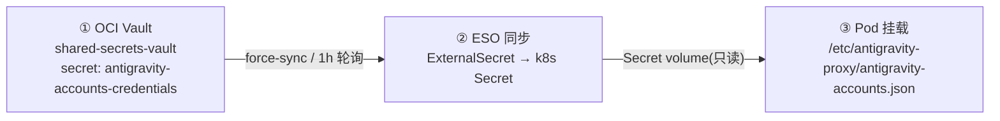

# 🔐 新增账号指引 + 复盘（Account Onboarding & Post-Mortem）

> 本文档记录如何在 `openai-proxy-for-antigravity` 的轮换池中**新增一个 Google AI Pro 账号**，
> 以及 2026-11-01 首次入池操作中踩过的坑与教训，供后续所有 Agent / 运维者参考。
>
> **维护原则：凭据绝不出现在本文档中。** 文中只出现资源标识（OCID / 名字 / 路径），
> 真实 token 一律通过 OCI Vault 或环境变量流转，严禁落盘到 Git。

---

## 1. 背景与关键概念

先认清这条「三层传送带」，否则会像我第一次一样把账号加错地方：



| 名词 | 说明 |
|---|---|
| **OCID** | Oracle Cloud 每个资源的全局唯一 ID，形如 `ocid1.<type>.<realm>.<region>.<tenant>.<unique>`。**同名 ≠ 同资源**，认准 OCID。 |
| **Vault** | OCI 的密钥仓库（免费）。一个 vault 里有若干 `secret`。 |
| **Secret** | vault 里的一条密钥，内容任意（这里是账号池 JSON）。 |
| **ESO** | External Secrets Operator，把 OCI Vault 的 secret 定期搬运成 k8s Secret。 |
| **轮换池** | `antigravity-accounts.json` 里的 `accounts[]` 数组，proxy 按 round-robin 轮换 + 429 失败切换使用。 |

---

## 2. 权威资源清单（认准这一份！）

> ⚠️ 同一 `antigravity-accounts-credentials` 名字存在**两份**，只有下面是线上生效的。

### ✅ 线上生效（正确目标）

| 资源 | 值 |
|---|---|
| Vault | `shared-secrets-vault`（原 `litellm-vault`，2026-11-01 已改名）|
| Vault OCID | `ocid1.vault.oc1.ap-singapore-1.gzviwf7saagpu.abzwsljrsb4del3q4df2zere7manjfm2dbjejvywf4qeh3lydtm74qgvjswa` |
| Compartment | `litellm-prod`（`ocid1.compartment.oc1..aaaaaaaaglzclbd4ewiasx5wyx6p2at74tm7w6r23s2hfwo7ucrddbxeowka`）|
| Region | `ap-singapore-1` |
| **Secret（真身）** | `antigravity-accounts-credentials` |
| **Secret OCID** | `ocid1.vaultsecret.oc1.ap-singapore-1.amaaaaaa5irm7faaf7jxozuqjvg6tuq2iw5sbnbdqlwerqoz7jbfe4b4vh2a` |
| k8s SecretStore | `oci-litellm-vault-store`（ns: `llm-system`）|
| k8s ExternalSecret | `antigravity-proxy-credentials`（ns: `llm-system`）|
| k8s Secret | `antigravity-proxy-credentials`（key: `antigravity-accounts.json`）|
| Deployment | `openai-proxy-for-antigravity`（ns: `llm-system`）|
| ConfigMap | `openai-proxy-config`（`CONFIG_DIR=/etc/antigravity-proxy`）|
| 集群入口 | 集群 B CP 节点 `43.139.214.231`（`sudo -n k3s kubectl ...`）|

### ❌ 废弃副本（不要动 / 不要参考）

| 资源 | 值 |
|---|---|
| Vault | `gateman-vault`（vault OCID 尾部 `…2pvxvudf5fhq`）|
| Secret OCID | `ocid1.vaultsecret.oc1.ap-singapore-1.amaaaaaa5irm7faamuao43tu55yd5kgnixlhgpk3ztsdpkspanyixfjeqixq` |
| 状态 | `DEPLOYMENT.md` 里写死的历史 OCID，已与线上脱钩，仅作历史留档 |

---

## 3. 账号条目 Schema

`antigravity-accounts.json` 结构（`version: 3`）：

```jsonc
{
  "version": 3,
  "activeIndex": 0,
  "activeIndexByFamily": { "claude": 0, "gemini": 0 },
  "accounts": [
    {
      "email": "<account-email>",
      "refreshToken": "<103 字符的 Google OAuth refresh token>",
      "addedAt": 1793524150278,        // ms 时间戳
      "lastUsed": 0,                    // 0 表示尚未被使用
      "rateLimitResetTimes": {}
      // 可选：projectId / managedProjectId（消费级账号可留空，走代理 fallback）
    }
  ]
}
```

要点：
- **`refreshToken` 是唯一身份键**——新增前先「按 refreshToken 去重」，避免重复入池。
- 消费级账号**无 `projectId`**，留空即可；proxy 会走 `loadCodeAssist` 或 fallback `rising-fact-p41fc`。
- 字段全覆盖 `AccountMetadataV3`：`email / refreshToken / projectId? / managedProjectId? / addedAt / lastUsed / lastSwitchReason? / rateLimitResetTimes? / coolingDownUntil? / cooldownReason?`。

---

## 4. 标准操作流程（新增一个账号）

### 4.1 拿到 refresh_token

两种方式（任选其一）：

**方式 A：从已登录的 agy CLI 直接读（推荐，最快）**

```bash
# 在任一已用目标账号登录过 agy 的机器上（Linux 无桌面 keyring 时走文件存储）
cat ~/.gemini/antigravity-cli/antigravity-oauth-token
# → {"token":{"refresh_token":"...","access_token":"..."}, ...}
# 取 token.refresh_token 与 id_token_email
```

> Windows 上 agy 走系统 Credential Manager（DPAPI 加密），SSH 网络登录会话**读不到**（`err=1312`），
> 故优先在 Linux 靶机（free-usw1 等）完成登录后取文件凭证。

**方式 B：走 proxy 自带认证向导重新授权一份独立凭据**

```bash
# 参考 QUICKSTART.md，浏览器登录后写入本地 antigravity-accounts.json
```

### 4.2 读取线上真实 accounts JSON

```bash
SECRET_ID="ocid1.vaultsecret.oc1.ap-singapore-1.amaaaaaa5irm7faaf7jxozuqjvg6tuq2iw5sbnbdqlwerqoz7jbfe4b4vh2a"

oci secrets secret-bundle get \
  --secret-id "$SECRET_ID" \
  --query 'data."secret-bundle-content".content' \
  --raw-output | base64 -d > /tmp/accts_orig.json && chmod 600 /tmp/accts_orig.json

python3 -c "import json;d=json.load(open('/tmp/accts_orig.json'));print([a['email'] for a in d['accounts']])"
```

### 4.3 追加新账号条目（去重 + 落盘）

```python
import json, time

d = json.load(open('/tmp/accts_orig.json'))
rt = "<新 refresh_token>"
email = "<账号邮箱>"

if any(a.get('refreshToken') == rt for a in d['accounts']):
    raise SystemExit('ALREADY_PRESENT')

d['accounts'].append({
    'email': email,
    'refreshToken': rt,
    'addedAt': int(time.time() * 1000),
    'lastUsed': 0,
    'rateLimitResetTimes': {},
})
json.dump(d, open('/tmp/accts_new.json', 'w'), indent=2)
```

### 4.4 写回 OCI Vault（新版本）

```bash
# 必须 base64 + contentType=BASE64 + stage=CURRENT
python3 -c "import json,base64;json.dump({'content':base64.b64encode(open('/tmp/accts_new.json','rb').read()).decode(),'contentType':'BASE64','stage':'CURRENT'}, open('/tmp/secret_content.json','w'))"

oci vault secret update \
  --secret-id "$SECRET_ID" \
  --secret-content file:///tmp/secret_content.json \
  --force
```

> 常见报错 `KeyError: 'contentType'` = 漏了 `contentType` 字段。
> 常见报错 `No such option: --secret-content-content` = 选项名是 `--secret-content`。

### 4.5 触发 ESO 立即同步 + 重启 Pod

```bash
ssh gateman@43.139.214.231

# 1) 强制同步（否则默认 1h 轮询）
sudo -n k3s kubectl -n llm-system annotate externalsecret antigravity-proxy-credentials \
  force-sync="$(date +%s)" --overwrite
sleep 8

# 2) 校验 k8s Secret 已更新
sudo -n k3s kubectl -n llm-system get secret antigravity-proxy-credentials \
  -o jsonpath='{.data.antigravity-accounts\.json}' | base64 -d | python3 -c \
  "import sys,json;print([a['email'] for a in json.load(sys.stdin)['accounts']])"

# 3) 重启 Deployment（滚动更新，老 Pod 会保留到新 Pod Ready）
sudo -n k3s kubectl -n llm-system rollout restart deploy/openai-proxy-for-antigravity
sudo -n k3s kubectl -n llm-system rollout status deploy/openai-proxy-for-antigravity --timeout=120s
```

### 4.6 验收（健康 + 账号数 + 真实请求 + 轮换）

```bash
POD=$(sudo -n k3s kubectl -n llm-system get pods \
  -l app.kubernetes.io/name=openai-proxy-for-antigravity \
  --field-selector=status.phase=Running -o jsonpath='{.items[0].status.podIP}')

curl -s "http://$POD:3000/health"                       # total 应为新账号数
curl -s "http://$POD:3000/admin/api/accounts"           # 确认新账号 lastUsed 会被更新

# 真实调用（antigravity 端点模型）
curl -s -X POST "http://$POD:3000/v1/chat/completions" -H "Content-Type: application/json" \
  -d '{"model":"claude-sonnet-4-6","messages":[{"role":"user","content":"Reply with exactly: OK"}],"stream":false,"max_tokens":16}'
```

验收标准：
- `/health` 的 `accounts.total` = 新增后数量；
- `/admin/api/accounts` 出现新账号且 `lastUsed` 从 0 变为非 0（证明真的被轮换到）；
- chat 请求返回 200 且 `content` 正常。

### 4.7 回滚

先把旧 JSON 备份好（`accts_orig.json`），回滚 = 用旧内容再次 `vault secret update` → 4.5 的 force-sync + restart 即可。

---

## 5. 复盘：本次踩的坑与教训

| # | 坑 | 根因 | 教训 |
|---|---|---|---|
| 1 | **改错了 Vault**：照着 `DEPLOYMENT.md` 的 OCID 更新，Pod 却还是旧账号 | 线上有两个**同名 secret**，`DEPLOYMENT.md` 写的是废弃的 `gateman-vault` 副本；真源在 `litellm-vault`(现 `shared-secrets-vault`) | **不要盲信文档里的 OCID**，先用 ESO 的 `SecretStore`/`ExternalSecret` 反查真源（「ESO 指向哪里，哪里就是线上」） |
| 2 | ESO 静默覆盖回旧值 | ESO 默认 1h 轮询，`force-sync` 前会把 k8s Secret 拉回它自己的源 | 改完 Vault 后**立即 force-sync**，再重启 Pod |
| 3 | 误以为「改 Vault 名会打断鉴权」 | 鉴权策略按 **compartment 名字**（`litellm-prod`）+ OCID 授权，不按 vault 名；ESO 用 vault OCID 引用 | 改 vault `display-name` 零风险；但**改 compartment / group / policy 名很危险** |
| 4 | `kubectl logs/exec` 偶发 502 / configmap 超时 | ARM 节点 kubelet 的 transient `failed to sync configmap cache` | 稍等/重试即可，别急着动节点；滚动更新期间新旧 Pod 并存属正常 |
| 5 | `gemini-2.5-flash` 请求 403 | 该模型号路由到 `gemini-cli → prod` 端点；只有 `gemini-3.x`/`claude`/`gpt-oss` 走 `antigravity → daily` 端点 | 测试用 `gemini-3.8-flash-tiered` / `claude-sonnet-4-6`，避免被模型名路由带偏 |
| 6 | Windows 上拿不到 agy 的 refresh token | Windows Credential Manager 绑定交互式登录会话，SSH 网络会话 `err=1312` | 取凭证统一走 **Linux 靶机的文件存储** `~/.gemini/antigravity-cli/antigravity-oauth-token` |

### 顺带发现（供后续决策）

- 该 client **不轮换 refresh token**（实测 refresh 返回无新 `refresh_token`），故一份 token 可被 proxy 长期复用、且不会把别处 agy 踢下线。
- OCI Vault 支持改 `display-name`，但 `litellm` 字样仍残留在 compartment / group / policy / k8s SecretStore 名上（功能无碍，属历史命名）。

---

## 6. 安全红线（必须遵守）

1. **凭据零 Git**：refresh token / `ANTIGRAVITY_CLIENT_SECRET` / 私钥，绝不写入本文档或任何仓库文件；凭据只走 Vault / Secret / 环境变量。
2. **只打印脱敏信息**：验收时只输出 `email` + `refreshToken 长度`，不 dump 明文。
3. **写操作三确认**：改 Vault / k8s 前，先确认 `SecretStore → vault OCID`、`ExternalSecret → remoteRef.key`、`target.name` 三者指向一致。
4. **动线上前先备份**：`secret-bundle get` 出当前 JSON 存本地（`chmod 600`），回滚有据可依。
5. **用完即清**：临时文件（`accts_orig.json` / `secret_content.json` / 节点上 `pod_acc.json` 等）操作完立即删除。

---

## 7. 相关文档

- `DEPLOYMENT.md`：部署架构（⚠️ 其中 Secret OCID 已过期，以本文档 §2 为准）
- `QUICKSTART.md`：本地认证向导用法
- `REQUIREMENTS.md`：需求与账号池演进记录
- `src/lib/auth/storage.ts`：`AccountMetadataV3` 完整字段定义
- `src/lib/antigravity/oauth.ts`：OAuth 换取/刷新逻辑