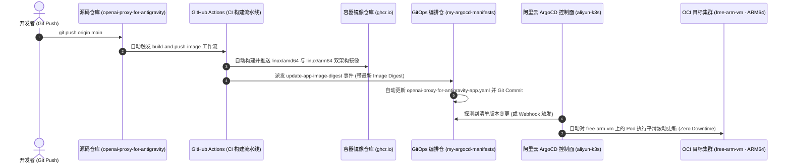

# 🚀 OpenAI Proxy for Antigravity

<div align="center">

**OpenAI-compatible gateway for Google's internal Antigravity API**

[](https://opensource.org/licenses/MIT)
[](https://nodejs.org)
[](https://www.docker.com/)
[](https://zed.dev)

*Unlock the full power of Google's internal AI models in your favorite local tools.*

</div>

> [!NOTE]
> **PRODUCTION READY**: This proxy is optimized for Google's latest **Gemini 3.8 Flash** and **Claude 4.6** models.
> Features dual-account Round-Robin rotation, automatic 429 failover, and cloud-native GitOps deployment.

---

## 📖 Overview

> 📚 **详细业务背景、需求与阶段路线图 (Requirements & Roadmap)**：参见 [REQUIREMENTS.md](REQUIREMENTS.md)。

**OpenAI Proxy for Antigravity** is a standalone local server that acts as a bridge between OpenAI-compatible clients (like [Zed IDE](https://zed.dev), VS Code, or Cursor) and Google's powerful **Antigravity API**.

### 🌟 Key Features

- **🔌 OpenAI Compatibility**: Drop-in replacement for any tool expecting an OpenAI-like API.
- **🔐 Standalone Authentication**: Built-in OAuth wizard to securely connect your Google account.
- **🔄 Multi-Account Rotation**: Automatically rotates between multiple Google accounts to maximize quota.
- **⚡ Smart Rate Limiting**: Detects 429 errors and switches accounts instantly.
- **📊 Admin Dashboard**: Web UI to monitor uptime, requests, and token usage.

---

## 🚀 云原生 GitOps 一键部署流程 (Cloud-Native GitOps CI/CD)

> 📚 **完整部署方案与架构拓扑**：详见 [DEPLOYMENT.md](DEPLOYMENT.md)。

本项目全面对齐生产级 GitOps 架构。开发者只需执行 `git push origin main`，整个镜像构建、版本派发、清单提交与集群滚动更新将**100% 全自动闭环**完成：



### 💡 核心设计与安全红线
1. **一键闭环更新**：代码提交至 `main` 分支后，GitHub Actions 自动构建多架构镜像，并跨仓库派发更新事件至 `my-argocd-manifests`，无需人工登录服务器操作。
2. **硬件算力绑定**：通过 `nodeSelector: kubernetes.io/hostname: free-arm-vm` 精准调度至 OCI 新加坡 4C24G ARM64 巨兽节点。
3. **机密零泄露托管**：多账号 OAuth 凭据 100% 托管于 OCI 硬件加密保管库（`litellm-vault`），通过 **External Secrets Operator (ESO)** 动态同步为 K8s Secret，Git 仓库零机密污染。
4. **严格内部隔离**：Service 严格限制为 **`ClusterIP: 3000`**，不暴露任何公网端口或 NodePort，专供同节点 **Higress AI Gateway** 作为上游前门消费。

---

## 🤖 Supported Models

| Model Name | Status | Capabilities | 说明 |
|------------|--------|--------------|------|
| `gemini-3.8-flash` | ✅ **Production** | 1M+ Context, 极速响应 | Google 最新主力 Flash 模型 (含 low/medium/high 各梯度) |
| `gemini-3-flash` | ✅ **Production** | 1M+ Context, 高吞吐 | 稳定高吞吐标准版 |
| `claude-sonnet-4-6` | ✅ **Production** | 200k Context, 深度推理 | Antigravity 渠道 Claude 旗舰主力 |
| `claude-opus-4-6-thinking` | ✅ **Production** | 200k Context, 深度思考 | 顶级思维链模型 |
| `gpt-oss-120b-medium` | ✅ **Production** | 开源顶流, 混合专家 | 官方中继开源顶流 |
| `antigravity-gemini-3-pro` | ✅ **Fallback** | 1M+ Context | 官方已废弃 Pro，已平滑无感升级至 Gemini 3.8 Flash |

---

## ⚡ Quick Start

### Prerequisites
- Node.js 20+ (or Docker)
- A Google Account

### 📦 Local Installation

1.  **Clone and Install**
    ```bash
    npm install
    npm run build
    ```

2.  **Authenticate**
    Run the setup wizard to connect your Google account(s).
    ```bash
    npm run auth
    ```
    *This opens your browser for OAuth login. Credentials are saved locally to `~/.config/antigravity-proxy`.*

3.  **Start the Server**
    ```bash
    npm start
    ```
    The proxy is now running at `http://localhost:3000`.

### 🐳 Docker Installation

If you prefer keeping your host clean:

1.  **Authenticate (One-time setup)**
    We need to generate the credentials file on your host machine first so Docker can mount it.
    ```bash
    npm run auth
    ```

2.  **Run with Docker Compose**
    ```bash
    npm run docker:up
    ```

    To view logs: `npm run docker:logs`
    To stop: `npm run docker:down`

---

## 🛠️ Configuration

### Integration with Zed IDE

We provide a helper script to generate the exact JSON configuration needed for Zed.

1.  **Generate Config:**
    ```bash
    npm run generate-zed-config
    ```

2.  **Apply Settings:**
    Copy the output into your Zed `settings.json`:

    ```json
    {
      "language_models": {
        "openai_compatible": {
          "Antigravity": {
            "api_url": "http://localhost:3000/v1",
            "available_models": [
              {
                "name": "antigravity-claude-opus-4-5-thinking",
                "display_name": "Claude Opus 4.5 Thinking (Antigravity)",
                "max_tokens": 200000,
                "max_output_tokens": 64000,
                "capabilities": {
                  "tools": true,
                  "images": true,
                  "parallel_tool_calls": true,
                  "prompt_cache_key": true
                }
              },
              {
                "name": "antigravity-gemini-3-pro",
                "display_name": "Gemini 3 Pro (Antigravity)",
                "max_tokens": 1048576,
                "max_output_tokens": 65535,
                "capabilities": {
                  "tools": true,
                  "images": true,
                  "parallel_tool_calls": true,
                  "prompt_cache_key": true
                }
              }
            ]
          }
        }
      }
    }
    ```

3.  **Select Model:**
    Open the Assistant Panel in Zed, click the provider dropdown, and select **Antigravity**.

---

## 📊 Admin Dashboard

Visit **[http://localhost:3000/admin](http://localhost:3000/admin)** to access the dashboard.

- **Status**: Check if your accounts are active or rate-limited.
- **Metrics**: View success rates and average response times.
- **Logs**: Inspect recent requests for debugging.

---

## ⚙️ Advanced Usage

### macOS Service (Auto-start)
Install the proxy as a LaunchAgent to start automatically when you log in.

```bash
# Install
./scripts/install-macos-service.sh

# Uninstall
./scripts/uninstall-macos-service.sh
```

### Environment Variables
You can customize the proxy via `.env` file or environment variables:

| Variable | Default | Description |
|----------|---------|-------------|
| `PORT` | `3000` | HTTP Server port |
| `LOG_LEVEL` | `info` | Logging verbosity (`debug`, `info`, `error`) |
| `CONFIG_DIR` | `~/.config/antigravity-proxy` | Custom path for credentials storage |
| `ADMIN_ENABLED` | `true` | Enable/Disable the web dashboard |

---

## ⚠️ Disclaimer

**Educational Purpose Only.**
This software is a proxy tool intended for personal, educational, and internal development use.

- This project is **not affiliated** with Google.
- Use of this tool may violate Google's Terms of Service.
- Your accounts may be suspended or rate-limited. **Use secondary accounts.**
- No guarantees are provided regarding API stability or availability.

---

## 📜 License

**Author:** [Alessandro Bruno](https://github.com/alessandrobrunoh)  
**License:** MIT

---

<div align="center">
  <sub>Made with ❤️ for the Open Source community</sub>
</div>
