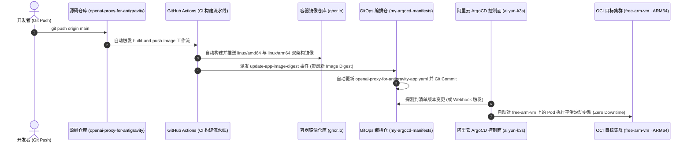

# 🚀 OpenAI Proxy for Antigravity

<div align="center">

**OpenAI-compatible gateway for Google's internal Antigravity API**

[](https://opensource.org/licenses/MIT)
[](https://nodejs.org)
[](https://www.docker.com/)
[](https://zed.dev)

*Unlock the full power of Google's internal AI models in your favorite local tools.*

</div>

> [!NOTE]
> **PRODUCTION READY**: This proxy is optimized for Google's latest **Gemini 3.8 Flash** and **Claude 4.6** models.
> Features dual-account Round-Robin rotation, automatic 429 failover, and cloud-native GitOps deployment.

---

## 📖 Overview

> 📚 **详细业务背景、需求与阶段路线图 (Requirements & Roadmap)**：参见 [REQUIREMENTS.md](REQUIREMENTS.md)。

**OpenAI Proxy for Antigravity** is a standalone local server that acts as a bridge between OpenAI-compatible clients (like [Zed IDE](https://zed.dev), VS Code, or Cursor) and Google's powerful **Antigravity API**.

### 🌟 Key Features

- **🔌 OpenAI Compatibility**: Drop-in replacement for any tool expecting an OpenAI-like API.
- **🔐 Standalone Authentication**: Built-in OAuth wizard to securely connect your Google account.
- **🔄 Multi-Account Rotation**: Automatically rotates between multiple Google accounts to maximize quota.
- **⚡ Smart Rate Limiting**: Detects 429 errors and switches accounts instantly.
- **📊 Admin Dashboard**: Web UI to monitor uptime, requests, and token usage.

---

## 🚀 云原生 GitOps 一键部署流程 (Cloud-Native GitOps CI/CD)

> 📚 **完整部署方案与架构拓扑**：详见 [DEPLOYMENT.md](DEPLOYMENT.md)。

本项目全面对齐生产级 GitOps 架构。开发者只需执行 `git push origin main`，整个镜像构建、版本派发、清单提交与集群滚动更新将**100% 全自动闭环**完成：



### 💡 核心设计与安全红线
1. **一键闭环更新**：代码提交至 `main` 分支后，GitHub Actions 自动构建多架构镜像，并跨仓库派发更新事件至 `my-argocd-manifests`，无需人工登录服务器操作。
2. **硬件算力绑定**：通过 `nodeSelector: kubernetes.io/hostname: free-arm-vm` 精准调度至 OCI 新加坡 4C24G ARM64 巨兽节点。
3. **机密零泄露托管**：多账号 OAuth 凭据 100% 托管于 OCI 硬件加密保管库（`litellm-vault`），通过 **External Secrets Operator (ESO)** 动态同步为 K8s Secret，Git 仓库零机密污染。
4. **严格内部隔离**：Service 严格限制为 **`ClusterIP: 3000`**，不暴露任何公网端口或 NodePort，专供同节点 **Higress AI Gateway** 作为上游前门消费。

### 🌐 生产集群访问地址与端口 (Deployment Topology)

| 访问途径 | 完整基准 URL (Base URL) | 目标端口 | 说明 |
|---|---|---|---|
| **K8s 集群内标准 DNS**<br>*(推荐·Higress 上游专用)* | `http://openai-proxy-for-antigravity.llm-system.svc.cluster.local:3000` | **`3000`** | 最优内网路由，同机 Higress 访问延迟 **< 0.2ms** |
| **K8s Service ClusterIP** | `http://10.43.250.150:3000` | **`3000`** | 集群内部稳定虚拟 IP |
| **宿主机本地单测** | `http://10.43.250.150:3000`<br>或 Pod 直连: `http://10.42.2.38:3000` | **`3000`** | 登录 `free-arm-vm` 宿主机时通过 `curl` 调试使用 |
| **集群外公网访问** | 🚫 **物理阻断 (无对外暴露)** | 无 | **安全隔离**：无公网 IP/端口，物理杜绝外部越权调用 |

> 📌 **标准 OpenAI 根路径 (OpenAI Base Path)**：
> `http://openai-proxy-for-antigravity.llm-system.svc.cluster.local:3000/v1`

### 📡 支持的 API Endpoint 清单 (Supported Endpoints)

| Method | Endpoint | 协议/格式 | 说明 |
|---|---|---|---|
| `POST` | `/v1/chat/completions` | OpenAI JSON / SSE 流式 | **核心对话补全**。支持非流式与 `stream: true` 逐字推流，内置双账号 Round-Robin 轮询与 429 自动无感 Failover |
| `GET` | `/v1/models` | OpenAI Models JSON | **模型目录查询**。返回当前代理支持的全量模型矩阵 |
| `GET` | `/health` | JSON 状态 | **健康检查探针**。K8s 存活/就绪探针目标，返回双账号可用数量与系统健康度 |
| `GET` | `/admin` | HTML5 Dashboard | **可视化监控看板**。直观查看双账号健康状态、配额消耗、最近调用流水与平均耗时 |
| `GET` | `/admin/api/accounts` | JSON 状态 | **账号状态 API**。查询各账号最后使用时间、冷却状态与重置倒计时 |
| `GET` | `/admin/api/metrics` | JSON 统计 | **度量监控 API**。统计各模型请求数（`requestsByModel`）、平均响应耗时与成功率 |

---

## 🤖 Supported Models

| Model Name | Status | Capabilities | 说明 |
|------------|--------|--------------|------|
| `gemini-3.8-flash` | ✅ **Production** | 1M+ Context, 极速响应 | Google 最新主力 Flash 模型，双账号自动轮询 |
| `claude-sonnet-4-6` | ✅ **Production** | 200k Context, 深度推理 | Antigravity 渠道 Claude 旗舰主力 |
| `claude-opus-4-6-thinking` | ✅ **Production** | 200k Context, 深度思考 | 顶级思维链模型 |
| `gpt-oss-120b-medium` | ✅ **Production** | 开源顶流, 混合专家 | 官方中继开源顶流 MoE |

### 🧠 深度思考与推理强度配置 (OpenCode & Reasoning Conventions)

本代理完美支持 **OpenCode 习惯** 与 OpenAI / Anthropic 思考预算规范，支持通过**模型后缀**或**请求体参数**自由调配思考程度：

#### 1. 模型名称后缀 (Model Suffixes)
直接在模型名称后追加思考层级后缀，代理会自动解析并剥离底模：
- `:low` (2,048 tokens 思考预算，轻量推理)
- `:medium` / `:med` (8,192 tokens 思考预算，标准平衡)
- `:high` (16,384 tokens 思考预算，深度探索)
- `:max` / `:ultra` (32,768 tokens 思考预算，极限推演)
- `:none` / `:off` / `:0` (禁用思考，直接输出)
- 自定义 Token 数值：如 `:4096` 或 `:16k`、`:32k`

> 示例：`"model": "gemini-3.8-flash:high"` 或 `"model": "claude-sonnet-4-6:low"`

#### 2. 请求体参数 (Request Body Parameters)
支持标准的 OpenAI / Anthropic 参数：
- **OpenAI 规范**：`"reasoning_effort": "low" | "medium" | "high" | "none"`
- **Anthropic / OpenCode 规范**：`"thinking": { "type": "enabled", "budget_tokens": 8192 }`
- **直接预算参数**：`"thinking_budget": 4096`

#### 3. 思维链输出格式 (Reasoning Output)
代理遵循行业标准，将模型思考过程与最终回答彻底解耦：
- **完整响应**：思考过程存入 `message.reasoning_content`，最终回答存入 `message.content`。
- **流式推送 (SSE)**：逐字推流时思考部分推入 `delta.reasoning_content`，回答部分推入 `delta.content`，完美适配 OpenCode 的折叠思考框展示。

---

## ⚡ Quick Start

### Prerequisites
- Node.js 20+ (or Docker)
- A Google Account

### 📦 Local Installation

1.  **Clone and Install**
    ```bash
    npm install
    npm run build
    ```

2.  **Authenticate**
    Run the setup wizard to connect your Google account(s).
    ```bash
    npm run auth
    ```
    *This opens your browser for OAuth login. Credentials are saved locally to `~/.config/antigravity-proxy`.*

3.  **Start the Server**
    ```bash
    npm start
    ```
    The proxy is now running at `http://localhost:3000`.

### 🐳 Docker Installation

If you prefer keeping your host clean:

1.  **Authenticate (One-time setup)**
    We need to generate the credentials file on your host machine first so Docker can mount it.
    ```bash
    npm run auth
    ```

2.  **Run with Docker Compose**
    ```bash
    npm run docker:up
    ```

    To view logs: `npm run docker:logs`
    To stop: `npm run docker:down`

---

## 🛠️ Configuration

### Integration with Zed IDE

We provide a helper script to generate the exact JSON configuration needed for Zed.

1.  **Generate Config:**
    ```bash
    npm run generate-zed-config
    ```

2.  **Apply Settings:**
    Copy the output into your Zed `settings.json`:

    ```json
    {
      "language_models": {
        "openai_compatible": {
          "Antigravity": {
            "api_url": "http://localhost:3000/v1",
            "available_models": [
              {
                "name": "antigravity-claude-opus-4-5-thinking",
                "display_name": "Claude Opus 4.5 Thinking (Antigravity)",
                "max_tokens": 200000,
                "max_output_tokens": 64000,
                "capabilities": {
                  "tools": true,
                  "images": true,
                  "parallel_tool_calls": true,
                  "prompt_cache_key": true
                }
              },
              {
                "name": "antigravity-gemini-3-pro",
                "display_name": "Gemini 3 Pro (Antigravity)",
                "max_tokens": 1048576,
                "max_output_tokens": 65535,
                "capabilities": {
                  "tools": true,
                  "images": true,
                  "parallel_tool_calls": true,
                  "prompt_cache_key": true
                }
              }
            ]
          }
        }
      }
    }
    ```

3.  **Select Model:**
    Open the Assistant Panel in Zed, click the provider dropdown, and select **Antigravity**.

---

## 📊 Admin Dashboard

Visit **[http://localhost:3000/admin](http://localhost:3000/admin)** to access the dashboard.

- **Status**: Check if your accounts are active or rate-limited.
- **Metrics**: View success rates and average response times.
- **Logs**: Inspect recent requests for debugging.

---

## ⚙️ Advanced Usage

### macOS Service (Auto-start)
Install the proxy as a LaunchAgent to start automatically when you log in.

```bash
# Install
./scripts/install-macos-service.sh

# Uninstall
./scripts/uninstall-macos-service.sh
```

### Environment Variables
You can customize the proxy via `.env` file or environment variables:

| Variable | Default | Description |
|----------|---------|-------------|
| `PORT` | `3000` | HTTP Server port |
| `LOG_LEVEL` | `info` | Logging verbosity (`debug`, `info`, `error`) |
| `CONFIG_DIR` | `~/.config/antigravity-proxy` | Custom path for credentials storage |
| `ADMIN_ENABLED` | `true` | Enable/Disable the web dashboard |

---

## ⚠️ Disclaimer

**Educational Purpose Only.**
This software is a proxy tool intended for personal, educational, and internal development use.

- This project is **not affiliated** with Google.
- Use of this tool may violate Google's Terms of Service.
- Your accounts may be suspended or rate-limited. **Use secondary accounts.**
- No guarantees are provided regarding API stability or availability.

---

## 📜 License

**Author:** [Alessandro Bruno](https://github.com/alessandrobrunoh)  
**License:** MIT

---

<div align="center">
  <sub>Made with ❤️ for the Open Source community</sub>
</div>
