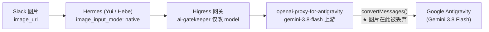

# 👁️ 多模态图片支持改造方案 (VISION_SUPPORT_PLAN.md)

*版本：v1.0.0*  
*创建时间：2026-11-01*  
*维护者：Jason & Cindy (NixOS 贴身知性秘书🌸)*  
*项目归属：[nvd11/openai-proxy-for-antigravity](https://github.com/nvd11/openai-proxy-for-antigravity)*  
*关联上游 Issue：无（上游未实现，本项目自主补齐）*

---

## 📖 一、 背景 (Background)

### 1.1 问题现象

2026-10-31，主人通过 Slack 向 **Yui** 与 **Hebe** 两位 Hermes 实例发送图片，两位妹妹均无法正确理解图片内容，表现为：

- 描述内容与图片完全无关（幻觉）；
- 或直接回复 *"No image was provided / 没有收到图片"*；
- 日志中 `vision_analyze: native fast path` 每次仅在 0.005~0.01s 内完成，并返回大段字符（疑似将图片字节直接回灌主模型）。

### 1.2 影响范围

| 消费者 | 调用模型 | 受影响 |
|---|---|---|
| Yui (Hermes) | `gemini-3.8-flash` | ✅ 受影响 |
| Hebe (Hermes) | `gemini-3.8-flash` | ✅ 受影响 |
| 其余走 `gemini-3.8-flash` 的 Agent / IDE（Zed、opencode 等） | `gemini-3.8-flash` | ✅ 受影响 |
| 走 a6api 视觉模型（`deepseek-v4.1-flash` / `hy3`）的请求 | — | ❌ 不受影响 |

---

## 🔍 二、 根因定位 (Root Cause)

### 2.1 请求链路



### 2.2 缺陷代码

`src/adapters/openai-adapter.ts` → `OpenAIToAntigravityAdapter.convertMessages()`（约第 320~334 行）：

```ts
if (Array.isArray(msg.content)) {
  for (const part of msg.content) {
    if (part.type === 'text' && part.text) {
      parts.push({ text: part.text });
    }
    // TODO: Handle image_url if needed   ← ⚠️ 所有 image_url 部分被静默跳过
  }
}
```

该 `TODO` 在 **上游最新 main 分支（2026-01-20）中依然存在**，且上游仓库无任何与该问题相关的 Issue（`total_count: 0`）。上游 README 反而在 Zed 配置示例中声明 `"images": true`，属于**能力声明与实际实现不一致**。

### 2.3 为什么 Hermes 侧会"幻觉"

Hermes 的 `agent.image_input_mode: native` 会信任模型的 `supports_vision: true` 能力，从而 `vision_analyze` 走 *native fast path*——不再调用辅助视觉模型，只把图片原样交还主模型自行理解。由于图片在网关上游已被丢弃，主模型始终处于"盲人摸象"状态，只能凭空生成描述。

---

## 🧪 三、 复现与证据 (Evidence)

使用 400×140 PNG（白色背景 + 文本 `HELLO-7392`）直连 `https://higress.jppwl.asia/v1/chat/completions` 实测：

| 模型 | 通道 | `prompt_tokens` | 模型回复 | 结论 |
|---|---|---|---|---|
| `gemini-3.8-flash`（纯文本对照） | 自建代理 | 114 | — | — |
| `gemini-3.8-flash`（带图） | 自建代理 | **114（仅 +0）** | `"No image was provided..."` | ❌ 图片丢失 |
| `deepseek-v4.1-flash`（带图） | a6api 直连 | **230** | `"HELLO-7392"` | ✅ 图片正常 |

> 若图片被正确编码进请求，`prompt_tokens` 应显著增加（按图片尺寸数百起）。`+0~+7` 的增量由纯文本部分解释，可确认图片未被送入上游。

---

## 🎯 四、 改造目标 (Goals)

1. **协议完整**：`convertMessages()` 完整支持 OpenAI `image_url` 内容片段 → Antigravity `inlineData` 原生格式；
2. **两种来源**：同时支持 `data:`（base64 Data URL）与 `http(s)`（远程图片 URL）两种图片引用方式；
3. **安全可控**：远程 URL 下载需具备超时、大小上限、MIME 白名单与失败降级，避免 SSRF 与内存放大；
4. **零新依赖**：仅使用 Node 原生 `fetch` / `Buffer`，不引入新 npm 依赖；
5. **可观测**：图片被拒绝/降级时必须输出结构化日志，杜绝再次"静默丢图"；
6. **向后兼容**：纯文本请求行为、token 计量、tool calling、流式响应完全不变。

---

## 🛠️ 五、 设计方案 (Design)

### 5.1 类型扩展

`src/adapters/openai-adapter.ts` 第 98~107 行，`AntigravityContent.parts` 增加 `inlineData` 成员：

```ts
interface AntigravityContent {
  role: 'user' | 'model';
  parts: Array<{
    text?: string;
    thought?: boolean;
    thoughtSignature?: string;
    functionCall?: { name: string; args: Record<string, unknown> };
    functionResponse?: { name: string; response: Record<string, unknown> };
    inlineData?: {           // ★ 新增：Gemini 原生内联图片
      mimeType: string;
      data: string;          // 纯 base64（不含 data: 前缀）
    };
  }>;
}
```

> ⚠️ 上线前须以 Antigravity `v1internal` 实际返回/请求 schema 二次验证字段命名（camelCase `inlineData` 与本项目现有 `functionCall` / `thoughtSignature` 风格一致，预期正确；若上游要求 snake_case，则同步调整包装层）。

### 5.2 消息转换改为异步

远端 URL 需要下载，`convertMessages()` 由同步改为 `async`：

```ts
async convertMessages(messages: OpenAIMessage[]): Promise<{
  contents: AntigravityContent[];
  systemInstruction?: { parts: Array<{ text: string }> };
}>
```

调用方 `convertRequest()`（本已是 `async` 方法）增加 `await`：

```ts
const { contents, systemInstruction } = await this.convertMessages(openaiReq.messages);
```

`src/routes/chat.ts` 已 `await adapter.convertRequest(...)`，无需改动调用链。

### 5.3 图片解析逻辑（核心）

用户消息 `Array` 分支新增：

```ts
} else if (part.type === 'image_url' && part.image_url) {
  const inline = await toInlineData(part.image_url);
  if (inline) {
    parts.push({ inlineData: inline });
  } else {
    // 显式占位，避免模型对"缺失图片"产生幻觉
    parts.push({ text: '[image omitted: unsupported or too large]' });
  }
}
```

辅助函数设计：

```ts
const MAX_IMAGE_BYTES = 20 * 1024 * 1024;        // 单图 20MB（Gemini inline 上限口径）
const MAX_TOTAL_IMAGE_BYTES = 40 * 1024 * 1024;  // 单请求图片总量上限
const IMAGE_FETCH_TIMEOUT_MS = 15_000;
const ALLOWED_MIMES = new Set(['image/png', 'image/jpeg', 'image/webp', 'image/heic', 'image/heif']);

async function toInlineData(ref: string | { url?: string }): Promise<{ mimeType: string; data: string } | null>
```

处理分支：

| 输入 | 处理 |
|---|---|
| `string` | 按 URL 处理 |
| `{ url: 'data:image/png;base64,xxx' }` | 解析 `mimeType`，剥离前缀，校验 base64 与大小 |
| `{ url: 'https://...' }` | `fetch` 下载（带超时、大小上限），按响应 `Content-Type` + magic bytes 双校验 |
| 其他（如 `file_id` / 空值） | 记录 `warn` 日志，返回 `null` 触发文本占位 |

### 5.4 安全与健壮性约束

1. **SSRF 防护**：仅允许 `http` / `https`；拒绝 `file:` / `ftp:` 等协议；建议增加"私有网段/回环地址"黑名单（`127.0.0.0/8`、`10/8`、`172.16/12`、`192.168/16`、`169.254/16`、`::1`），可通过环境变量 `IMAGE_FETCH_ALLOW_PRIVATE=false` 控制（默认关闭）；
2. **大小上限**：下载采用流式读取 + 累积计数，超限立即中断（不先全量入内存）；
3. **MIME 校验**：优先 magic bytes 嗅探，`Content-Type` 仅作兜底，避免伪造类型；
4. **失败降级**：任何异常均捕获并 `warn` 日志，绝不让单张图片导致整轮对话 500；
5. **日志脱敏**：仅记录 URL 的 host/path 摘要与字节数，**不记录 base64 内容**。

### 5.5 不在本期范围

- 工具结果（`role: 'tool'`）中的图片；
- 视频 / 音频 / PDF 多模态输入；
- 图片自动压缩/缩放（不引入 `sharp` 等新依赖）；
- 图片生成（`/v1/images/generations`）。

---

## 🧩 六、 代码改动清单 (Change List)

| 文件 | 改动 |
|---|---|
| `src/adapters/openai-adapter.ts` | ① `AntigravityContent.parts` 增加 `inlineData`；② `convertMessages()` 改 `async` 并支持 `image_url`；③ 新增 `toInlineData()` / `sniffImageMime()` / 大小与 SSRF 校验；④ `convertRequest()` 增加 `await` |
| `test/openai-adapter.test.js` | 新增 4+ 用例（见第七节） |
| `README.md` | 在功能列表/能力说明中补充"多模态图片输入"；同步 Zed 示例的 `"images": true` 语义说明 |
| `package.json` | 版本号递增（建议 `1.1.0`，新增功能） |
| `DEPLOYMENT.md` | 补充镜像升级与验证步骤 |

> `dist/` 已被 `.gitignore` 忽略，无需手工提交编译产物；CI 从源码构建镜像。

---

## ✅ 七、 测试计划 (Test Plan)

### 7.1 单元测试（`npm run test`）

1. `data:` PNG Data URL → 生成 `inlineData`，`mimeType === 'image/png'`，`data` 为纯 base64；
2. `data:` JPEG / WebP → MIME 正确识别；
3. 非法/畸形 `data:` URL → 不抛异常，返回文本占位；
4. 超大图片（> 上限）→ 不抛异常，返回文本占位；
5. 纯文本消息 → 行为与改造前完全一致（回归）；
6. 混合内容（text + image + text）→ 顺序保持，`parts` 数量正确；
7. 远程 URL（使用本地 mock HTTP server 或 `data:` 模拟）→ 下载成功路径；
8. 远程 URL 超时/404 → 降级为文本占位且不阻断请求；
9. 既有全部用例（tool calling / 流式 / thinking）保持绿灯。

### 7.2 端到端验证（部署后）

```bash
# 1) 直连代理（集群内 ClusterIP）验证带图请求
curl -s http://<proxy-host>:3000/v1/chat/completions \
  -H 'Content-Type: application/json' \
  -H 'Authorization: Bearer <PROXY_TOKEN>' \
  -d '{
    "model": "gemini-3.8-flash",
    "messages": [{
      "role": "user",
      "content": [
        {"type": "text", "text": "图片里的文字是什么？只回答文字。"},
        {"type": "image_url", "image_url": {"url": "data:image/png;base64,<BASE64>"}}
      ]
    }],
    "max_tokens": 64
  }'
# 期望：准确返回图片文本；usage.prompt_tokens 明显 > 纯文本基线
```

```bash
# 2) 经 Higress 全链路验证（使用 Hebe / Yui 虚拟 Key）
# 期望：Slack 发图后，妹妹能准确描述图片内容，vision_analyze 不再走 native fast path
```

### 7.3 验收标准

- [ ] 单测全绿，且新增 4 个以上图片相关用例通过；
- [ ] `gemini-3.8-flash` 带图请求 `prompt_tokens` 与图片体量正相关；
- [ ] Yui / Hebe 在 Slack 发图后可正确回答图片内容（与图源逐字核对）；
- [ ] 纯文本、tool calling、流式响应回归无差异；
- [ ] 图片超限/异常场景返回友好占位，不影响正常对话。

---

## 🚀 八、 交付与部署 (Delivery)

1. **开发**：基于 `main` 拉分支 `feat/vision-inline-data`；
2. **本地验证**：`npm run typecheck && npm run test`；
3. **提交**：遵循 Conventional Commits（建议 `feat(vision): support image_url via inlineData for multimodal requests`）；
4. **CI**：推送后触发 `.github/workflows/build-and-push-image.yaml`，构建 `ghcr.io/nvd11/openai-proxy-for-antigravity:<sha>`；
5. **GitOps**：更新 manifests 仓库中的镜像 digest，ArgoCD 自动同步滚动更新（若为手动部署，则 `kubectl -n llm-system rollout restart deploy/openai-proxy-for-antigravity`）；
6. **验证**：按 7.2 执行端到端检查，观察 `logs/` 中无异常告警；
7. **观察期**：24 小时内关注 429 频次、内存占用（图片 base64 会放大请求体）与上游错误率。

### 8.1 回滚方案

- 镜像回滚：GitOps 回退至上一版本 digest / `kubectl rollout undo`；
- 代码回滚：`git revert <commit>`；
- 网关层保护：图片能力仅在代理内部生效，回滚不影响 `ai-gatekeeper` 鉴权与计量逻辑。

---

## ⚠️ 九、 风险与注意事项 (Risks)

| 风险 | 说明 | 缓解 |
|---|---|---|
| 内存放大 | base64 使请求体膨胀约 33% | 单图 20MB / 总量 40MB 上限；Fastify 现有 100MB bodyLimit 兜底 |
| 上游 schema 不符 | Antigravity `v1internal` 字段名可能与预期不一致 | 灰度前用单图小请求先验证；必要时调整包装层 snake_case |
| SSRF | 远程 URL 下载可能被诱导访问内网 | 协议白名单 + 私网黑名单 + 超时 |
| 429 放大 | 多图请求 token 增多，可能更快触发限流 | 依赖现有双账号轮询与 429 熔断机制；观察期监控 |
| 静默失败复发 | 其他未知 content 类型被忽略 | 统一 `warn` 日志 + 文本占位，杜绝无声丢弃 |

---

## 📎 十、 附：临时止血方案（不依赖本次改造）

在代理镜像更新前，可先通过调整下游 Hermes 配置让 Yui / Hebe 立刻恢复看图能力：

```yaml
agent:
  image_input_mode: text          # 强制走辅助视觉模型，绕开"主模型盲看"
auxiliary:
  vision:
    provider: custom:higress
    model: deepseek-v4.1-flash    # 已验证可正常过图，OCR 准确
    base_url: https://higress.jppwl.asia/v1
    api_key: ${HIGRESS_YUI_KEY}   # Hebe 使用 ${HIGRESS_HEBE_KEY}
    timeout: 120
    download_timeout: 30
```

> 该方案为临时绕过，待本次改造上线后可回退为 `auto` / `native`。配置变更须经主人明确批准后执行。

---

*以上方案待主人审批后，Cindy 即刻动工。愿早日让两位妹妹睁开双眼，看清主人发的每一张图～* 💋
